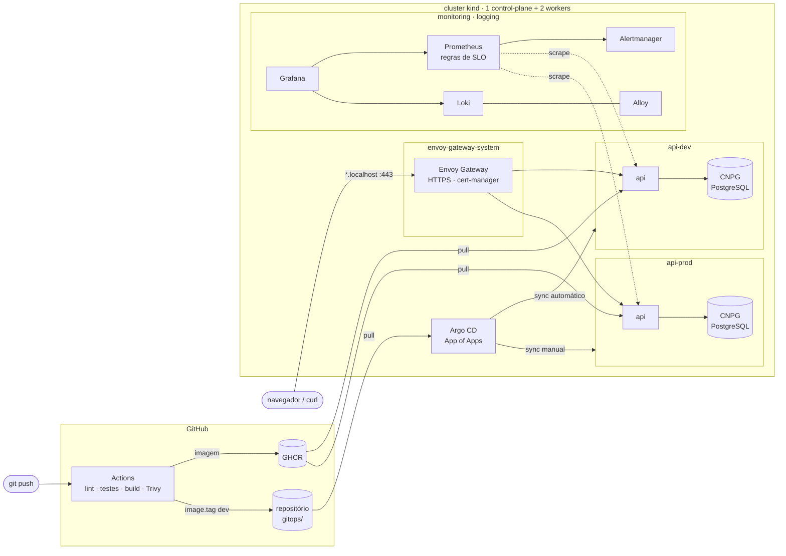

# platform-lab

[](https://github.com/esleyms/platform-lab/actions/workflows/ci.yaml)
[](https://github.com/esleyms/platform-lab/actions/workflows/validate.yaml)
[](https://github.com/esleyms/platform-lab/actions/workflows/e2e.yaml)

Laboratório de plataforma Kubernetes reproduzível com um comando. Reúne, em escala de notebook, as peças de uma plataforma interna: cluster como código, entrega contínua por GitOps, roteamento com Gateway API, banco gerenciado por operator, observabilidade orientada a SLO e controles de segurança por padrão.

É um ambiente de estudo e demonstração, não um produto. As escolhas que só fazem sentido em laboratório estão marcadas como tal no código e em [Limitações](#limitações).

## Arquitetura



O CI nunca acessa o cluster. Ele publica a imagem e altera o estado desejado no Git; o Argo CD, de dentro do cluster, puxa e aplica. É o modelo pull do GitOps: sem credenciais do cluster fora dele.

## Componentes

| Camada | Ferramenta | Versão |
|---|---|---|
| Cluster | kind via Terraform (`tehcyx/kind`) | kind 0.33, Kubernetes 1.37 |
| GitOps | Argo CD (App of Apps, AppProjects) | chart 10.14.0 / app 3.6.1 |
| Tráfego | Envoy Gateway (Gateway API) + cert-manager | 1.10.0 / 1.21.3 |
| Banco | CloudNativePG | operator 1.30.1 |
| Segredos | Sealed Secrets (chave própria) | 0.41.2 |
| Métricas e alertas | kube-prometheus-stack | 92.21.2 |
| Logs | Loki (monolítico) + Grafana Alloy | chart 21.0.0 / 1.21.3 |
| Escala | metrics-server + HPA | 0.9.0 |
| Aplicação | Python 3.13, FastAPI, psycopg 3, prometheus-client | |
| CI | GitHub Actions, Trivy, GHCR | |
| Host | Ansible (Docker, ferramentas, hardening) | ansible-core 2.22 |

As versões ficam fixadas no código (charts nas Applications, actions por SHA, ferramentas em `.mise.toml`) e o Dependabot abre PRs de atualização.

## Como rodar

**Requisitos:** Docker com pelo menos 10 GiB de memória disponível para containers, 4 CPUs, 40 GB livres, e as ferramentas de `.mise.toml` (`mise install` instala todas). No Windows, use o WSL2 e ajuste o limite de memória em `.wslconfig`.

```bash
make up        # preflight, cluster, bootstrap e espera a plataforma ficar saudável
make urls      # endereços e credenciais
make ca        # exporta a CA do laboratório para o curl/navegador confiar
make down      # destrói o cluster
```

O primeiro `make up` leva de 8 a 15 minutos, quase todo em download de imagens. Depois disso:

| Serviço | Endereço |
|---|---|
| Argo CD | https://argocd.localhost |
| Grafana | https://grafana.localhost (dashboard *API: SLO e sinais de ouro*) |
| API dev | https://api-dev.localhost/api/items |
| API prod | https://api.localhost/api/items |

```bash
curl --cacert ~/.config/platform-lab/ca.crt https://api-dev.localhost/api/items \
  -H 'content-type: application/json' -d '{"name":"primeiro item"}'
```

`*.localhost` resolve para 127.0.0.1 nos navegadores e no curl, sem mexer em `/etc/hosts`.

### Primeiro deploy em prod

Prod exige o token de escrita da API, que vai para o Git cifrado:

```bash
make seal ENV=prod                  # gera gitops/envs/prod/manifests/api-token.sealedsecret.yaml
git add gitops/envs/prod && git commit -m "feat(prod): token da API" && git push
make sync-prod
```

## Fluxo de entrega

1. Merge na `main` alterando `apps/api/` dispara o workflow `ci`: lint, testes (unitários e de integração com PostgreSQL), build, scan com Trivy e push para o GHCR com a tag `sha-<commit>`.
2. O mesmo workflow grava a nova tag em `gitops/envs/dev/values.yaml`. O Argo CD sincroniza dev sozinho.
3. Para promover, o workflow `promote` abre um PR copiando a tag de dev para `gitops/envs/prod/values.yaml`. Depois do merge, o sync de prod é manual.
4. **Rollback** é reverter o commit da tag e sincronizar. O histórico de produção é o `git log` de `gitops/envs/prod`.

O rolling update usa `maxUnavailable: 0` e `maxSurge: 1`: um pod novo só entra quando passa na readiness, e só então um antigo sai. Um `preStop` de 5 s dá tempo para o Envoy parar de mandar tráfego antes do SIGTERM.

## Decisões técnicas

| Decisão | Por quê | Registro |
|---|---|---|
| Gateway API com Envoy Gateway, não Ingress NGINX | O ingress-nginx foi aposentado em março de 2026 e não recebe mais correções de segurança | [ADR 0001](docs/adr/0001-gateway-api.md) |
| CloudNativePG, não chart Bitnami | As imagens Bitnami passaram para um repositório legado sem atualizações em 2025 | [ADR 0002](docs/adr/0002-cloudnativepg.md) |
| Monorepo com app, chart e estado GitOps | Um repositório para mostrar o fluxo inteiro; o loop do CI é evitado pelo `GITHUB_TOKEN` | [ADR 0003](docs/adr/0003-monorepo-gitops.md) |
| Alloy, não Promtail | Promtail chegou ao fim de vida em 2 de março de 2026 | [ADR 0004](docs/adr/0004-alloy.md) |
| Sealed Secrets com chave gerada fora do cluster | Os SealedSecrets do Git continuam decifráveis depois de `make down && make up` | [ADR 0005](docs/adr/0005-sealed-secrets-chave-propria.md) |

## O que está implementado

**Confiabilidade.** Probes separadas (a liveness não depende do banco, para um banco fora do ar não reiniciar todos os pods), startup probe, requests em todos os containers, HPA por CPU com janela de estabilização, PodDisruptionBudget em prod, topology spread entre nós e encerramento gracioso.

**Segurança.** Imagem multi-stage rodando como UID 10001 com filesystem somente leitura e todas as capabilities removidas; ServiceAccount sem token montado; NetworkPolicy default-deny por namespace com liberações explícitas; RBAC de humanos por grupo (edit em dev, view em prod); AppProject `workloads` limitado ao próprio repositório e aos namespaces da API; ResourceQuota e LimitRange; Gateway que só aceita rotas de namespaces autorizados; actions fixadas por SHA; Trivy bloqueando vulnerabilidades HIGH/CRITICAL com correção disponível.

**Observabilidade.** Métricas RED da API com rótulo de rota por template (cardinalidade controlada), dois SLOs (disponibilidade 99,5% e p95 abaixo de 300 ms) com alertas multi-janela de burn rate, dashboard versionado, logs JSON no Loki com o nível como label. Detalhes em [docs/slo.md](docs/slo.md).

## Estrutura

```
apps/api/            código, testes e Dockerfile da API
charts/api/          Helm chart próprio da API
infra/terraform/     cluster kind
gitops/
  bootstrap/         Application raiz (aplicada uma vez pelo bootstrap)
  apps/              Applications e AppProjects que o Argo CD cria a partir da raiz
  platform/          values dos charts de plataforma e manifestos de gateway/monitoramento
  envs/{dev,prod}/   values da API, banco, NetworkPolicies, RBAC e quotas por ambiente
ansible/             preparação de uma VM Ubuntu para rodar o laboratório
scripts/             bootstrap, preflight, selagem de segredos, validação
docs/                ADRs, SLOs, runbook e exercícios de troubleshooting
```

## Documentação

- [docs/slo.md](docs/slo.md): definição dos SLOs, cálculo do error budget e dos alertas
- [docs/runbook.md](docs/runbook.md): o que fazer quando cada alerta dispara
- [docs/troubleshooting-labs.md](docs/troubleshooting-labs.md): falhas para provocar e diagnosticar
- [ansible/](ansible/site.yml): preparar uma VM limpa com `ansible-playbook site.yml`

## Limitações

- Um único cluster faz o papel de dev e prod, separados por namespace. Em produção seriam clusters (ou contas) diferentes.
- Loki e Prometheus usam disco local e retenção curta (3 dias); a janela do SLO no dashboard é de 3 dias pelo mesmo motivo, não os 30 dias usuais.
- A CA é autoassinada e o metrics-server usa `--kubelet-insecure-tls`, ambos aceitáveis só em laboratório.
- O Alertmanager não tem receptor configurado: os alertas aparecem na UI e no Grafana, mas não notificam ninguém.
- O teste e2e valida a branch `main`, porque o Argo CD lê o estado desejado direto do GitHub.

## Próximos passos

- Rodar a mesma plataforma num EKS ou DOKS pequeno via Terraform, com custo estimado e destruição documentada.
- Notificações do Alertmanager e do Argo CD.
- Argo Rollouts para canary guiado pelas métricas de SLO.
- Assinatura de imagem com cosign e verificação por política de admissão.

## Licença

[MIT](LICENSE)
